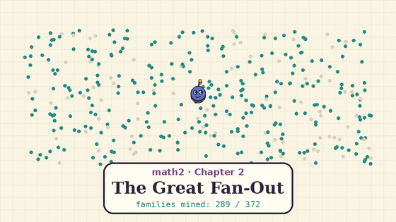

# math2 — cross-family corollaries of openai/math

[](media/math2-chapter2.mp4)

*Chapter 2, "The Great Fan-Out": click for the version with sound. Chapter 1,
"The Theorem That Was Already There": [video](media/math2-tale.mp4) ·
[gif](media/math2-tale.gif). `media/render.py` and `media/render_ch2.py`
regenerate both.*

[](https://github.com/atimics/math2/actions/workflows/lean.yml)

What follows from combining the 722 AI-generated manuscripts in
[openai/math](https://github.com/openai/math) (snapshot
[`adc7f12`](https://github.com/openai/math/tree/adc7f1241b42e322a6451854ab7e4b4c146bf78a)),
that the corpus itself does not say.

OpenAI's pipeline posed about 4,000 problems one at a time and checked
results one statement at a time. Nothing in it looks at how the 372 result
families relate. This repo does that: it finds redundant results, chains, and
consequences that combine families, then proves the strongest ones in Lean.

**What is and isn't verified.** The Lean results are *conditional
implications*: "if OpenAI's statement X holds, then Y". Lean checks the step
from X to Y. It does not check X: OpenAI's own proofs are not rebuilt here,
the vendored comparator files contain `sorry`, and the audit confirms no
corollary depends on them. The catalogue has 14 such checked implications,
31 complete written derivations and 5 research leads, and labels each one.
In all there are 116 audited Lean declarations in the main build, and 11 more in
two separately built libraries (two of those are OpenAI's own theorems). Independent referee agents
re-checked every entry against the sources.

One entry goes further. **CL-1 is proved end to end in Lean.** OpenAI's own proof
of family 172 is rebuilt here from byte-identical upstream files and composed with
ours. The result, `EndToEnd.algebraic_ramsey_iff_cospherical`, has no unproved
premise: a point set with algebraic coordinates and full span is Euclidean Ramsey iff
it is spherical.

> **Everything here is conditional.** OpenAI's results are claims; several
> have no formalization, and OpenAI warns that some unformalized ones may have
> issues. Every Lean theorem in this repo takes OpenAI's statement as an
> explicit hypothesis, so it is never assumed as an axiom. If an OpenAI claim
> is wrong, only the corollaries that cite it fall.

## Headline

**OpenAI's Landau–Siegel statement follows from its 7/8 statement.** Family 003
formalizes these separately:

| OpenAI comparator | Claim | Proof in corpus |
|---|---|---|
| `DirichletSevenEighths.lean` | every Dirichlet `L(s,χ) ≠ 0` for `Re s > 7/8` (except the pole) | paper of Sept 30 |
| `SiegelZeros.lean` | real zeros satisfy `(1−β) log q ≥ c` for some unspecified `c > 0` | a *separate* paper of Oct 1, which does not cite the first |
| `QuasiRiemannHypothesis.lean` | `ζ(s) ≠ 0` for `Re s > 7/8` | separate comparator |

`Corollaries/SevenEighths.lean` derives the second and third from the first
alone, with explicit `c = log 3 / 8`. It also proves the stronger uniform
statement that no nontrivial Dirichlet `L`-function, of any modulus, has a
real zero in `(7/8, 1)`. `Fidelity/Checks.lean` re-proves both against
OpenAI's *verbatim* comparator types in the kernel. A third route, through
family 029's Hecke theorem, is listed as a lead in the docs (NT-3).

This shows redundancy between two *claims*. It does not verify the 7/8
theorem. Nor does it make the Oct 1 paper worthless: its proof is independent
of the 7/8 paper, so it would survive a flaw there.

## What's here

| Path | Contents |
|---|---|
| [`docs/COROLLARIES.md`](docs/COROLLARIES.md) | 50 entries mined from all 372 families, plus tension checks, each tagged **L** (Lean-checked conditional implication, 14), **D** (complete written derivation, 31) or **Lead** (research lead, 5); every entry refereed |
| [`docs/review/`](docs/review/README.md) | **Expert review packets** for the three entries that matter most: NT-9 (full BSD for ≥ 83.75% of curves), TC-4 (directed APSP in `n^2.5082`) and CL-1 (algebraic Euclidean Ramsey ⇔ spherical). Each has the questions for a specialist, verbatim premises, the bridge, failure modes and a reproducer script; CI runs the reproducers |
| [`docs/RESEARCH_PRIORITIES.md`](docs/RESEARCH_PRIORITIES.md) | Six research-agenda consequences (RP-1 … RP-6) with written derivations, classical references and follow-up targets; RP-4 is the full derivation behind NT-9 |
| `Corollaries/` | Lean library. Mathlib only, with OpenAI statements as hypotheses (`Hypotheses.lean`) |
| `Fidelity/` | Kernel checks that those hypotheses equal OpenAI's own comparator types, plus applications to OpenAI's exact statements |
| `FidelityAlt/` | Kernel checks against comparator files that clash with `Fidelity`'s (same OpenAI names), built separately; CI checks that the shared definitions are byte-identical |
| `OAI/Combinatorics/EuclideanRamsey/`, `EndToEnd/` | Byte-identical copies of OpenAI's own Lean proof of family 172 (31 files, Mathlib only, no `sorry`; CI diffs them against upstream), and CL-1 composed with it, leaving no unproved premise |
| `Fidelity/Vendor/` | Byte-identical copies of twenty-two `openai/math` comparator files (Apache-2.0, proofs are `sorry` upstream); CI diffs them against upstream |
| `Fidelity/AxiomGuard.lean`, `scripts/` | Two independent axiom audits: the Lean command `#assert_standard_axioms` fails elaboration on anything beyond `propext`, `Classical.choice` and `Quot.sound`, and `check_axioms.py` matches `#print axioms` output to the exact requested names (no duplicates, none missing, no Lean errors; self-tested in CI) |
| [`docs/ENGINEERING_SELECTION.md`](docs/ENGINEERING_SELECTION.md) | Workload and baseline screening, plus an executable small-network sampler with a conditional finite-step bias guarantee in [`experiments/curveball/`](experiments/curveball/README.md) |

### Lean-checked conditional implications

| Declaration | Statement | Families |
|---|---|---|
| `real_zero_le_seven_eighths` | real zeros of nontrivial Dirichlet `L`-functions are `≤ 7/8`, for every modulus | 003 |
| `siegel_of_sevenEighths` | OpenAI's Siegel-zero comparator, with `c = log 3 / 8` | 003 ⇒ 003′ |
| `zeta_of_sevenEighths` | OpenAI's zeta comparator | 003 ⇒ 003″ |
| `rat_affine_pi_liouvilleWith_eq_Iic`, `rat_affine_pi_irrationalityExponent`, `mobius_pi_liouvilleWith_eq_Iic` | the Liouville exponents of `rπ + s`, and of every rational Möbius image of `π`, are exactly `(−∞, 2]`, so the irrationality exponent is exactly 2. This includes a Dirichlet lower bound (`liouvilleWith_two_of_irrational`) and `LiouvilleWith` inversion invariance, both new relative to Mathlib | 017 |
| `directFiniteness_transfer`, `not_isStablyFiniteRing_of_kaplansky` | Kaplansky's counterexample survives every ring map out of OpenAI's finite field, and stable finiteness fails over **every** characteristic-2 field, including 𝔽₂ | 197 |
| `not_surjunctive_of_kaplansky`, `not_surjunctive_of_finitelyPresented`, `oddKaplansky_mainClaim_iff` | each Kaplansky comparator gives a non-surjunctive group (Gottschalk fails), checked against OpenAI's own `cellular` map. The cellular conjuncts in the odd-characteristic claim are redundant | 197 |
| `idempotent_of_directFiniteness_witness` | `ab = 1`, `ac = 0`, `c ≠ 0` ⇒ `ba` is an idempotent other than 0 and 1, so the torsion-free counterexample also breaks the idempotent conjecture in characteristic 2 | 197 ⇒ 196, 207 |
| `zeroDivisor_group_not_leftOrderable` | OpenAI's torsion-free zero-divisor group is not left-orderable | 196 |
| `liouville_agreement_density`, `liouville_eq_iff_parity` | `#{n ≤ X : λ(a₁n+b₁) = λ(a₂n+b₂)} = ⌊X⌋/2 + O(X/(log X)^c)`, i.e. Ω-parity agreement along affine forms has density ½ | 007 |
| `scalar_henon_nonexistence` | scalar Hardy–Hénon Liouville theorem in the range `n − 2 < 2(n + A)/(p + 1)` | 370 |
| `symmetric_mahler_bourgainMilman` | Bourgain–Milman with the optimal base: `vol(K)vol(K°) ≥ (2/π)ⁿκₙ²` | 087 |
| `nagata_equal_multiplicity`, `nagata_ten_points` | equal-multiplicity Nagata; `d ≥ 3m + 1` at 10 very general points (a specialization) | 039 |
| `ramsey_of_cospherical_of_algebraic`; end to end: `EndToEnd.algebraic_ramsey_iff_cospherical`, `EndToEnd.ramsey_of_cospherical_of_rational` | Euclidean-Ramsey ⇔ spherical for point sets with algebraic coordinates, so Graham's conjecture holds for them (e.g. any finite set of rational points on a circle). The `EndToEnd` versions use OpenAI's rebuilt proof and have no unproved premise | 172 |
| `ramsey_log_ratio`, `ramsey_ratio_tendsto_atTop` | `r(s+1,t)/r(s,t) = t/(log t)^{1+o(1)}` for `s ≥ 5` | 170 |
| `twoPoint_binary_iff_ordinaryElliott`, `ostmann_main_iff_inverseGoldbach` | OpenAI formalized the same theorems twice: two Elliott comparators are equivalent, and two Ostmann comparators are identical | 007, 013 |

## Corrections to earlier claims

Our first pass suggested that "effective class numbers" was a consequence
missing from the corpus. **That was wrong.** The 11/12 paper in family 003
already states `h(D) ≫ √|D| / log log |D|` and the completeness of Euler's
idoneal numbers. The genuinely unstated items are the ones listed above and
in the docs.

## Coverage and limits

- All 372 families mined, and every entry refereed. Lean also confirms some
  content the corpus already states: Green–Tao, `χ(ℝ²) ∈ {6,7}`, and a
  superpolynomial LP-lift bound. These are listed separately and not counted.
- An external review of commit `77ab999` found four issues: the audit matched counts rather than names, the old "W" tier overstated sketches, the animation's wording omitted conditionality, and the π statement overclaimed. All four are fixed; details are at the end of `docs/COROLLARIES.md`.
- Lean status is whatever CI says. A corollary counts as checked only when the
  workflow is green on the commit you're reading.
- "Unstated in the corpus" was established by grep over the corpus text. It is
  not a literature search, and several items are already known once you grant
  the corpus input (marked in the docs).

### Earlier AI results and successor problems

[`docs/CDC_RESEARCH_AGENDA.md`](docs/CDC_RESEARCH_AGENDA.md) tracks what the
July Cycle Double Cover breakthrough settles and which sharper problems remain:
five-cover compression, orientations and flows, connected-cycle counts, and
matroid boundaries. This separate dossier does not change the catalogue counts.

## Building

The separate [CDC experiment](experiments/cdc/README.md) constructs and checks
finite cubic-graph covers, compares palette merging with unrestricted search,
and retains a Petersen K6 palette obstruction plus a checked five-cover.
Its Python reproduction commands and limitations are documented there.


```sh
lake exe cache get
lake build Corollaries Fidelity FidelityAlt UpstreamEuclideanRamsey EndToEnd
lake env lean scripts/Axioms.lean            # likewise AxiomsAlt.lean, AxiomsEndToEnd.lean
```

## Engineering experiments

[`experiments/quota/`](experiments/quota/README.md) compares dense, routing-network,
and per-vertex hybrid degree-quota reductions with the same exact matching backend.
It includes independent witness checks and measured results: smaller `V+E` did
not produce faster solves in this pilot. Dense remains the default.

## License

Apache-2.0. Files under `Fidelity/Vendor/`, `FidelityAlt/Vendor/` and
`OAI/` are © OpenAI, from `openai/math`, and unmodified under Apache-2.0.
