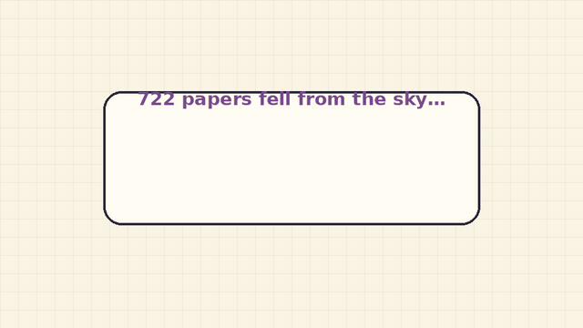

# math2 — cross-family corollaries of openai/math

[](media/math2-tale.mp4)

*Click for the version with sound. `media/render.py` regenerates the animation.*

[](https://github.com/atimics/math2/actions/workflows/lean.yml)

What follows from combining the 722 AI-generated manuscripts in
[openai/math](https://github.com/openai/math) (snapshot
[`adc7f12`](https://github.com/openai/math/tree/adc7f1241b42e322a6451854ab7e4b4c146bf78a)),
that the corpus itself does not say.

OpenAI's pipeline posed about 4,000 problems one at a time and checked
results one statement at a time. Nothing in it looks at how the 372 result
families relate. This repo does that: it finds redundant results, chains, and
consequences that combine families, then proves the strongest ones in Lean.

**What is and isn't verified.** The Lean results are *conditional
implications*: "if OpenAI's statement X holds, then Y". Lean checks the step
from X to Y. It does not check X: OpenAI's own proofs are not rebuilt here,
the vendored comparator files contain `sorry`, and the audit confirms no
corollary depends on them. The catalogue mixes 7 such checked implications,
5 complete written derivations and 26 research leads, and labels each one.

> **Everything here is conditional.** OpenAI's results are claims; several
> have no formalization, and OpenAI warns that some unformalized ones may have
> issues. Every Lean theorem in this repo takes OpenAI's statement as an
> explicit hypothesis, so it is never assumed as an axiom. If an OpenAI claim
> is wrong, only the corollaries that cite it fall.

## Headline

**OpenAI's Landau–Siegel statement follows from its 7/8 statement.** Family 003
formalizes these separately:

| OpenAI comparator | Claim | Proof in corpus |
|---|---|---|
| `DirichletSevenEighths.lean` | every Dirichlet `L(s,χ) ≠ 0` for `Re s > 7/8` (except the pole) | paper of Sept 30 |
| `SiegelZeros.lean` | real zeros satisfy `(1−β) log q ≥ c` for some unspecified `c > 0` | a *separate* paper of Oct 1, which does not cite the first |
| `QuasiRiemannHypothesis.lean` | `ζ(s) ≠ 0` for `Re s > 7/8` | separate comparator |

`Corollaries/SevenEighths.lean` derives the second and third from the first
alone, with explicit `c = log 3 / 8`. It also proves the stronger uniform
statement that no nontrivial Dirichlet `L`-function, of any modulus, has a
real zero in `(7/8, 1)`. `Fidelity/Checks.lean` re-proves both against
OpenAI's *verbatim* comparator types in the kernel. A third route, through
family 029's Hecke theorem, is listed as a lead in the docs (NT-3).

This shows redundancy between two *claims*. It does not verify the 7/8
theorem. Nor does it make the Oct 1 paper worthless: its proof is independent
of the 7/8 paper, so it would survive a flaw there.

## What's here

| Path | Contents |
|---|---|
| [`docs/COROLLARIES.md`](docs/COROLLARIES.md) | 38 entries across 289 families, plus tension checks, each tagged **L** (Lean-checked conditional implication, 7), **D** (complete written derivation, 5) or **Lead** (research lead, 26) |
| [`docs/RESEARCH_PRIORITIES.md`](docs/RESEARCH_PRIORITIES.md) | Six research-agenda consequences with complete written derivations, classical references, and concrete follow-up targets |
| `Corollaries/` | Lean library. Mathlib only, with OpenAI statements as hypotheses (`Hypotheses.lean`) |
| `Fidelity/` | Kernel checks that those hypotheses equal OpenAI's own comparator types, plus applications to OpenAI's exact statements |
| `Fidelity/Vendor/` | Byte-identical copies of eight `openai/math` comparator files (Apache-2.0, proofs are `sorry` upstream); CI diffs them against upstream |
| `Fidelity/AxiomGuard.lean`, `scripts/` | Two independent axiom audits: the Lean command `#assert_standard_axioms` fails elaboration on anything beyond `propext`, `Classical.choice` and `Quot.sound`, and `check_axioms.py` matches `#print axioms` output to the exact requested names (no duplicates, none missing, no Lean errors; self-tested in CI) |

### Lean-checked conditional implications

| Declaration | Statement | Families |
|---|---|---|
| `real_zero_le_seven_eighths` | real zeros of nontrivial Dirichlet `L`-functions are `≤ 7/8`, for every modulus | 003 |
| `siegel_of_sevenEighths` | OpenAI's Siegel-zero comparator, with `c = log 3 / 8` | 003 ⇒ 003′ |
| `zeta_of_sevenEighths` | OpenAI's zeta comparator | 003 ⇒ 003″ |
| `pi_not_liouvilleWith`, `rat_affine_pi_not_liouvilleWith`, `pi_not_liouville` | `rπ + s` is not `LiouvilleWith p` for any `p > 2`: irrationality exponent `≤ 2` (the `≥ 2` side, Dirichlet's theorem, is not formalized here) | 017 |
| `directFiniteness_transfer` | Kaplansky's direct-finiteness counterexample survives every ring map out of OpenAI's finite field | 197 |
| `idempotent_of_directFiniteness_witness` | `ab = 1`, `ac = 0`, `c ≠ 0` ⇒ `ba` is an idempotent other than 0 and 1, so the torsion-free counterexample also breaks the idempotent conjecture in characteristic 2 | 197 ⇒ 196, 207 |
| `zeroDivisor_group_not_leftOrderable` | OpenAI's torsion-free zero-divisor group is not left-orderable | 196 |
| `liouville_agreement_density`, `liouville_eq_iff_parity` | `#{n ≤ X : λ(a₁n+b₁) = λ(a₂n+b₂)} = ⌊X⌋/2 + O(X/(log X)^c)`, i.e. Ω-parity agreement along affine forms has density ½ | 007 |
| `scalar_henon_nonexistence` | scalar Hardy–Hénon Liouville theorem in the range `n − 2 < 2(n + A)/(p + 1)` | 370 |

## Corrections to earlier claims

Our first pass suggested that "effective class numbers" was a consequence
missing from the corpus. **That was wrong.** The 11/12 paper in family 003
already states `h(D) ≫ √|D| / log log |D|` and the completeness of Euler's
idoneal numbers. The genuinely unstated items are the ones listed above and
in the docs.

## Coverage and limits

- Mined: 289 of 372 families. **Not yet mined:** theoretical computer science,
  combinatorics and logic (83 families).
- An external review of commit `77ab999` found four issues: the audit matched counts rather than names, the old "W" tier overstated sketches, the animation's wording omitted conditionality, and the π statement overclaimed. All four are fixed; details are at the end of `docs/COROLLARIES.md`.
- Lean status is whatever CI says. A corollary counts as checked only when the
  workflow is green on the commit you're reading.
- "Unstated in the corpus" was established by grep over the corpus text. It is
  not a literature search, and several items are already known once you grant
  the corpus input (marked in the docs).

## Building

```sh
lake exe cache get
lake build Corollaries Fidelity
lake env lean scripts/Axioms.lean
```

## License

Apache-2.0. Files under `Fidelity/Vendor/` are © OpenAI, from
`openai/math`, and unmodified under Apache-2.0.
